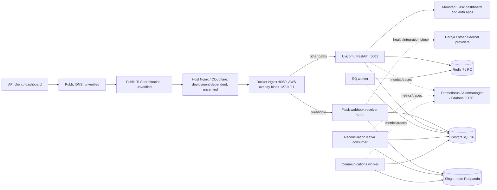

# Runtime Architecture

## Request flow

Dashed/external edges, DNS, TLS, host proxy, and public endpoint behavior are
configuration or operational intent, not live-verified connections.

## Trace and important limits

1. The AWS deployment guide describes public hostname → Elastic IP → host
   Nginx/TLS → Docker Nginx → backend, but it names the legacy hostname
   `api.pesaguard.victorkipruto.com`.
2. The AWS Compose overlay binds only its newly added Nginx mapping to
   `127.0.0.1:8080`. Compose's effective merged output retains all base-file port
   mappings for other services; direct application and data services can bypass
   that Nginx boundary.
3. Docker Nginx forwards webhook paths to `webhook_receiver` and other paths to
   `dashboard_api`; its body limit is 1 MiB and read timeout is 60 seconds.
4. FastAPI/Uvicorn on 5001 mounts the Flask app. The separate webhook process
   defaults to 5000. The Dockerfile health check defaults to 5001, which mismatches
   the webhook process.
5. Reconciliation uses manual Kafka offset commits after successful processing;
   this is source-level behavior. No live broker, event ordering, retry, or duplicate
   delivery verification was performed.
6. Dependency `depends_on` entries describe start ordering, not proven readiness;
   no services were started in this audit.

## Unknowns

Actual public DNS/TLS, host firewall, Cloudflare configuration, trusted-proxy count,
production service environment, Uvicorn process count, database connection totals,
consumer-group/topic settings in the target environment, and the end-to-end
ingestion-to-notification trace are unverified.

